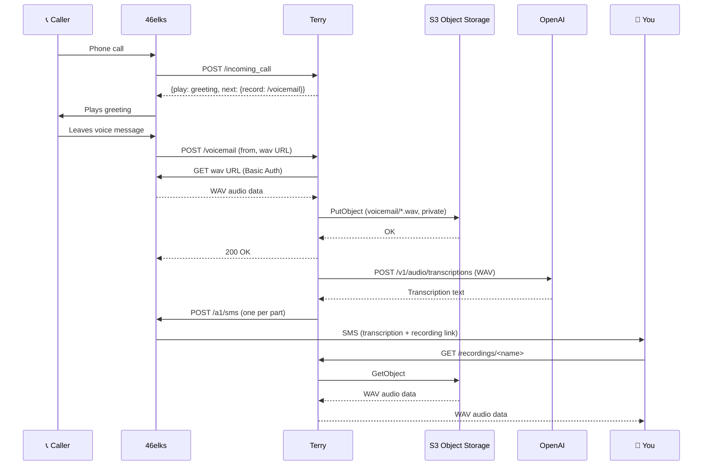

# Terry

Named after legendary Chelsea defender John Terry, who never let anything get
past him. Neither does this voicemail.

Terry is a personal voicemail service. Callers hear your greeting and can
leave a message. The message is transcribed and sent to you as a text message
(several, if it's long). It uses the [46elks](https://46elks.com/) telephony
API and [OpenAI](https://platform.openai.com/) speech-to-text, and stores
recordings privately in S3-compatible object storage (e.g. Hetzner).

## What you need

- Somewhere to host the service (e.g. [Runway](https://runway.horse)) 🇪🇺
- S3-compatible object storage (e.g. [Hetzner](https://www.hetzner.com)) 🇪🇺
- A [46elks](https://46elks.se) 🇪🇺 account and a phone number with `voice_start` set to `https://<WEBHOOK_USER>:<WEBHOOK_PASS>@<hostname>/incoming_call`
- An [OpenAI](https://platform.openai.com/) API key
- An audio file with your greeting (mp3, ogg or wav format), hosted at a public URL

## How it fits together



If the caller hangs up during the greeting, nothing is recorded and no SMS is
sent. 46elks gets its response as soon as the recording is stored.
Transcription and SMS delivery happen in the background, so a slow
transcription can't time out the callback.

Messages that need more than ten concatenated SMS segments (about 1520
characters, or 660 if the text needs Unicode encoding) are split at word
boundaries and numbered, e.g. `(1/2) Voicemail from +46…`. If
transcription fails, or the recording is over OpenAI's 25 MB limit, you still
get an SMS saying who called.

Every SMS ends with a link to `<HOST>/recordings/<name>`, which streams the
recording from object storage. Recordings are uploaded without a public ACL;
the link's random name is what grants access, so treat it like a secret.

Recordings stop after 120 seconds (46elks' default `timelimit`) or when the
caller presses `#`.

## Environment variables

| Variable | Description | Required |
|---|---|---|
| `ELKS_USERNAME` | 46elks API username | Yes |
| `ELKS_PASSWORD` | 46elks API password | Yes |
| `SMS_FROM` | SMS sender: your 46elks number, or an alphanumeric name (max 11 chars) | Yes |
| `SMS_TO` | Your phone number, in E.164 format (e.g. `+46701234567`) | Yes |
| `S3_ACCESS_KEY` | Object storage access key | Yes |
| `S3_SECRET_KEY` | Object storage secret key | Yes |
| `S3_BUCKET_NAME` | Bucket name for storing recordings | Yes |
| `S3_ENDPOINT` | S3-compatible endpoint URL | Yes |
| `S3_REGION` | Storage region | Yes |
| `OPENAI_API_KEY` | OpenAI API key | Yes |
| `OPENAI_TRANSCRIPTION_MODEL` | Transcription model (default: `gpt-4o-transcribe`) | No |
| `HOST` | Public URL of this service (used for 46elks callbacks and recording links) | Yes |
| `VOICEMAIL_AUDIO` | URL of the greeting audio file | Yes |
| `WEBHOOK_USER` | Basic Auth username 46elks must use for webhooks | Yes |
| `WEBHOOK_PASS` | Basic Auth password 46elks must use for webhooks | Yes |
| `PORT` | HTTP port (default: `3000`) | No |

## Running

```sh
go build -o terry
./terry
```

The `Dockerfile` builds a static binary on a distroless image. Runway's Go
buildpack lags behind the Go version in `go.mod`, so it's used instead; keep
the `golang` image tag in sync with `go.mod`.

## Development

```sh
make test       # go test -race
make lint       # golangci-lint (config in .golangci.yml)
make fmt        # gofmt -s + goimports via golangci-lint
make vulncheck  # govulncheck
```
